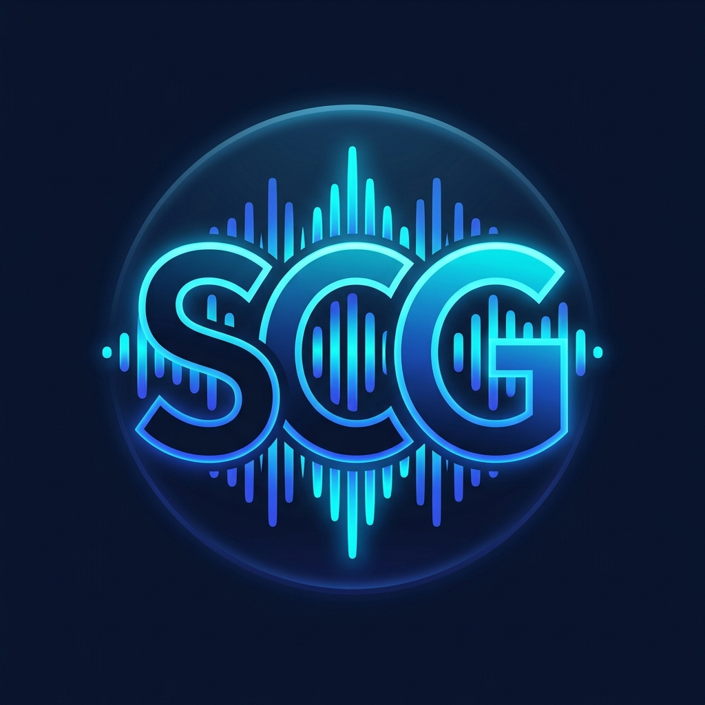

# 🎙️ SesYazOku (SCG)

<p align="center">
  
</p>

<p align="center">
  <strong>Canlı Ses Kaydı, Harici Uygulamalardan Ses Yakalama (Zoom, Meet, WhatsApp, Telefon), Çoklu Konuşmacı Ayrımı (Kişi 1, Kişi 2, Kişi 3...), PDF/Kamera Döküman Yönetimi ve Google Drive Bulut Senkronizasyonu</strong>
</p>

<p align="center">
  <a href="../../actions"></a>
  <a href="docs/SesYazOku.apk"></a>
  
  
  
</p>

---

## 🌐 Canlı Web Sayfası & APK İndirme

Bu projede **GitHub Pages** üzerinde canlı olarak çalışan kapsamlı bir tanıtım ve indirme sayfası bulunmaktadır:

- **Canlı Web Tanıtım Sayfası**: `https://<kullanici-adiniz>.github.io/<depo-adiniz>/`
- **Doğrudan APK İndir**: [docs/SesYazOku.apk](docs/SesYazOku.apk) (~25.1 MB, Android 8.0+)
- **Tarayıcıda Canlı Test Simülatörü**: Web sayfasında canlı mikrofon kaydı, konuşmacı simülasyonu ve PDF çıktısı anında test edilebilir.

---

## 📱 SesYazOku'nun 7 Temel Modülü

### 0. 🔑 Google ile Giriş & Bulut Entegrasyonu
- **Güvenli Kimlik Doğrulama:** Google Sign-In (Credential Manager) ile tek tıkla güvenli oturum.
- **Entegrasyonlar:** İlerleyen aşamalarda Gmail, Mesajlar ve Google Drive yedeklemeleri için güvenli yetkilendirme.

### 1. 🎙️ Kayıt Sekmesi
- **Canlı Mikrofon Kaydı:** İsteğe bağlı olarak mikrofon açık veya kapalı yapılabilir.
- **Harici Uygulamalardan Canlı Ses Alma:** Zoom, Google Meet, WhatsApp, Telegram, video konferanslar ve normal telefon konuşmalarından arka planda ses kaydı alma (Foreground Service).
- **Cihazdaki Sesleri Yükleme:** Cihazda önceden kaydedilmiş `.mp3`, `.m4a`, `.wav`, `.ogg`, `.aac`, `.3gp` gibi tüm ses dosyalarını ekleyip kullanabilme.

### 2. ✍️ Transkriptor Sekmesi (Konuşmacı Ayrımı)
- **Sesten Yazıya Dönüştürme:** Yüksek doğruluklu Speech-to-Text motoru.
- **Çoklu Konuşmacı Tespiti:** Ses kaydı içinde kaç kişi varsa tespit edilip metinde sıralı olarak **Kişi 1**, **Kişi 2**, **Kişi 3** şeklinde ayrıştırılması.
- **Zaman Damgaları & İstatistik:** Cümle başlangıç-bitiş süreleri ve konuşma süresi dağılımı.

### 3. 📂 Döküman Sekmesi & Yönetim
- **Dosya Adı Düzenleme:** Sesten dönüştürülmüş dökümanların isimlerini değiştirme.
- **Kapak/Önizleme Resmi Ekleme:** Dahili/harici hafızadan görsel seçme veya doğrudan **kamera ile anlık fotoğraf çekerek** dökümana kapak resmi atama.
- **PDF Oluşturma:** Tek dokunuşla cihaz hafızasına profesyonel PDF olarak kaydetme.
- **Hızlı Paylaşım & Drive:** Mesajlaşma uygulamalarıyla (WhatsApp, Telegram) paylaşma ve Google Drive'a bulut yedekleme.

### 4. ⚙️ Ayarlar Sekmesi
- **Tema:** Koyu (Dark) ve Açık (Light) Material 3 teması.
- **Dil Seçimi:** Türkçe ve İngilizce arayüz dili.
- **Ses İnce Ayarları:** Ses örnekleme frekansı, gürültü bastırma filtresi ve mikrofon hassasiyeti.

### 5. ✨ Özel Açılış Deneyimi & SCG Logosu
- **Splash Animasyonu:** Açılışta sabit logo yerine **"SesYazOku"** yazısı ve çevresinde dönen parlama efekti (Glow effect).
- **Özel Logo:** Canlı ses dalgası ekolayzırı ve **SCG** harflerinden oluşan marka simgesi.

### 6. 🛡️ Açılış İzinleri
- Program açılışında şeffaf bilgilendirmeyle Dahili/Harici Depolama, Mikrofon ve Kamera erişim izin talepleri.

### 7. 💬 Üreticiye Mesaj (Geri Bildirim)
- Programın işleyişi, eksik kısımları ve geliştirme önerileri hakkında kullanıcıların doğrudan geliştiriciye mesaj gönderebileceği entegre form.

---

## 🛠️ Yerel Geliştirme & Derleme

```bash
# Depoyu klonlayın
git clone https://github.com/<kullanici-adiniz>/<depo-adiniz>.git
cd <depo-adiniz>

# Testleri çalıştırın
./gradlew testDebugUnitTest

# Debug APK derleyin
./gradlew assembleDebug
```

Derlenen APK: `app/build/outputs/apk/debug/app-debug.apk` ve `docs/SesYazOku.apk`.

---

## 📄 Lisans
Bu proje Apache License 2.0 ile lisanslanmıştır.
